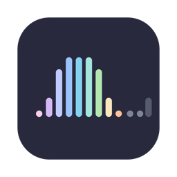
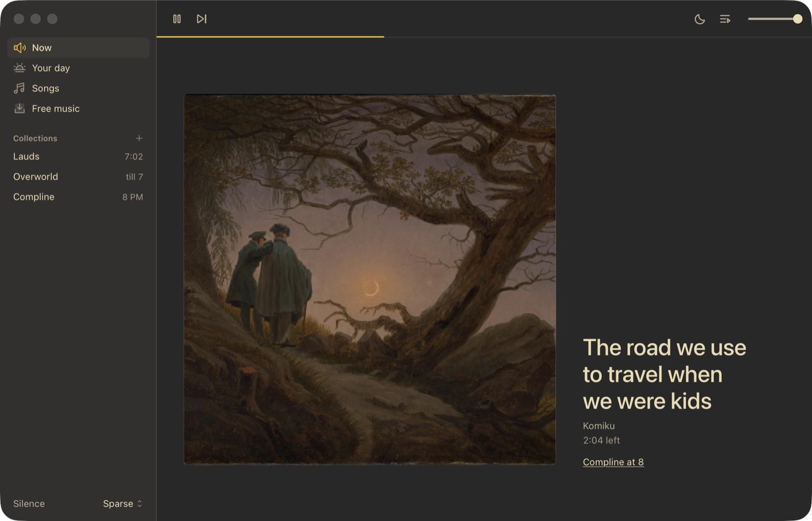
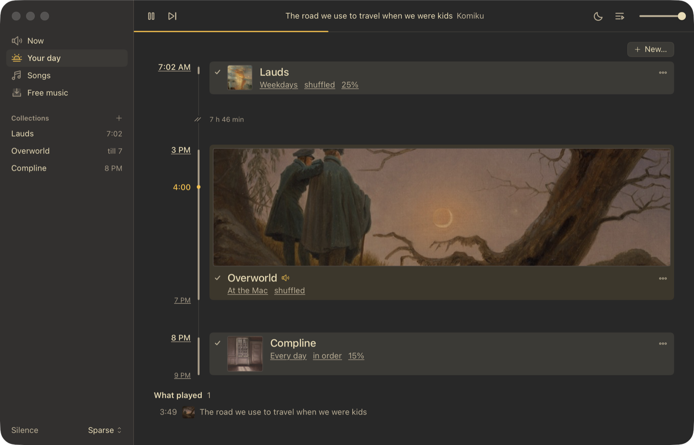
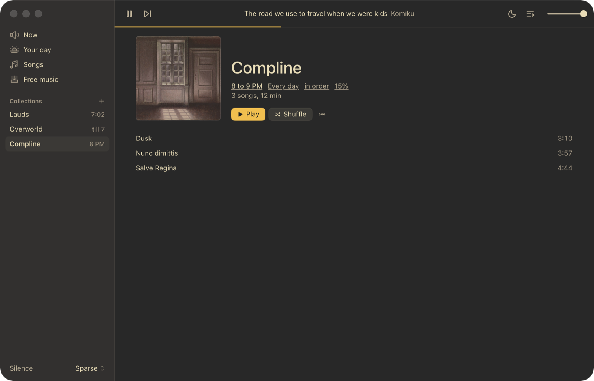
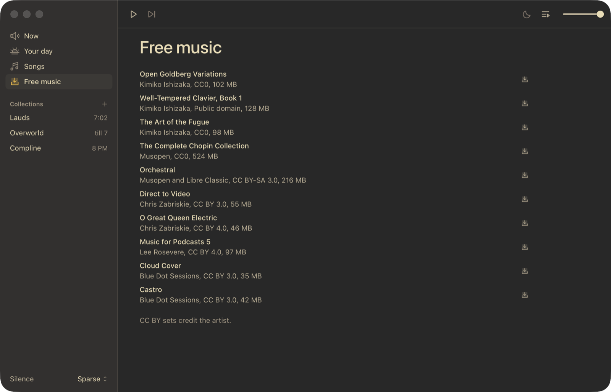
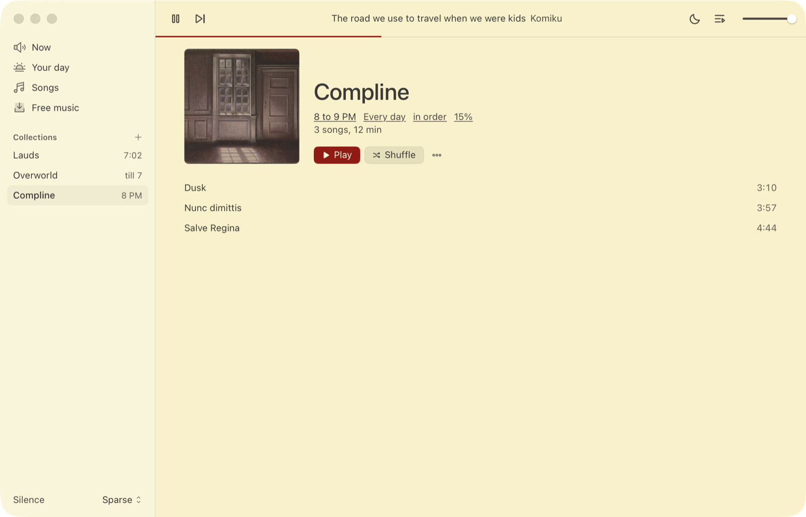

<p align="center">
  
</p>

<h1 align="center">sottova</h1>

<p align="center">
  a soundtrack for your mac.<br>
  your own music, on a schedule, with real silence between the songs.
</p>

<p align="center">
  <a href="https://github.com/TheSecondComing123/sottova/releases/latest"><b>download</b></a> ·
  <a href="#build-it"><b>build it</b></a> ·
  <a href="#scripting"><b>scripting</b></a> ·
  <a href="#what-it-changes-on-your-mac"><b>what it changes on your mac</b></a> ·
  <a href="LICENSE"><b>GPL-3.0</b></a>
</p>



## what it is

sottova plays your music the way Minecraft plays its soundtrack. a song rises out of silence, falls back into it, and then nothing plays for a while. you choose how long.

a playlist that never stops turns into wallpaper. a song that arrives after ten minutes of quiet gets heard.

you can also give music a place in your day: a collection that wakes you at 7:02, one that plays at your desk in the afternoon, one that winds down at 8.

- **needs** macOS 26 Tahoe or later
- **plays** your own files, with no streaming and no account
- **stays** on your Mac, with no analytics

## your day



- **set a time.** a collection starts itself once or on the days you pick, at its own volume, and can stop after a while
- **it wakes the Mac.** sottova schedules a system wake two minutes before each timed row
- **or only while you're here.** a row can play just while you're at the Mac, and wait while other audio is playing or your calendar has something on
- **it moves on.** a collection split into parts can play the next part each time

## the silence

| preset | gap | fade in / out |
| --- | --- | --- |
| Minecraft | 10–20 min | 6 s / 8 s |
| Sparse | 3–8 min | 6 s / 8 s |
| Short | 30 s–2 min | 4 s / 6 s |
| Breath | 2–15 s | 3 s / 4 s |
| Continuous | none, 4 s crossfade | 3 s / 3 s |

Minecraft's own delay between overworld tracks is 10 to 20 minutes. set your own gaps and fades, save them as a preset, or give one album or collection its own silence.

## your library



- plays folders of mp3, aac, alac, flac, wav, aiff and ogg, and watches them for new files
- levels every song to the same loudness (−18 LUFS by default, peaks under −1 dBTP), measured once per file
- shuffles without repeats: everything plays once before anything comes round again
- collections are `.m3u8` files in `~/Music/Sottova Playlists`, so other players can open them, and you can split them into named parts
- covers from a file, or from public-domain paintings at the Met, the Art Institute of Chicago and Cleveland
- a queue, a sleep timer that eases the music down, and seeking that fades back in instead of starting loud
- trim where a song really starts and ends to skip a spoken intro or applause, without touching the file
- Now Playing, media keys and a menu bar menu all work
- reopens where you left off, in the song or in the silence

## free music



no music yet? download a set of openly licensed albums in one click, like Kimiko Ishizaka's Open Goldberg Variations (CC0). each one lands in `~/Music/Sottova Library` as plain mp3s with its cover and a `credits.txt`.

## make it yours



Monochrome, Catppuccin, Everforest, Flexoki, Gruvbox, Kanagawa, Nord, Rosé Pine and Tokyo Night, in light or dark where the palette has both.

## download

get the zip from [releases](https://github.com/TheSecondComing123/sottova/releases/latest). it needs macOS 26 on Apple silicon.

the build isn't signed by Apple yet, so macOS blocks it the first time. unzip it, move Sottova to Applications, then run:

```sh
xattr -dr com.apple.quarantine /Applications/Sottova.app
```

## build it

you need Xcode 26.

```sh
git clone https://github.com/TheSecondComing123/sottova.git
cd sottova
scripts/run.sh        # debug build, then opens it
scripts/release.sh    # release zip in .build/release
```

`release.sh` signs with a Developer ID when `SOTTOVA_SIGN_ID` is set and notarizes when `SOTTOVA_NOTARY` names a `notarytool` keychain profile. without them the build is ad-hoc signed, and other Macs need the quarantine step above.

`swift test` runs the engine headless: the state machine, offline renders of the audio graph, and the EBU Tech 3341 loudness signals.

## scripting

links, for hotkey tools and Raycast:

```
sottova://play
sottova://pause
sottova://toggle
sottova://skip
sottova://preset/minecraft
sottova://sleep/45
sottova://sleep/after
sottova://sleep/off
```

every state change rewrites `~/Library/Application Support/Sottova/status.json`:

```json
{"preset":"Short","status":"resting","title":"clip2","nextTrackAt":"2026-10-28T16:42:10Z"}
```

and posts the same thing as the distributed notification `com.alanbagel.sottova.status`. for SketchyBar:

```sh
sketchybar --add event sottova_status com.alanbagel.sottova.status \
           --subscribe sottova sottova_status
```

## your files

everything sits in `~/Library/Application Support/Sottova`, as plain files:

- `library.json`: watched folders and the loudness of every file
- `profile.json`: your settings, plus the albums that have their own gaps
- `resume.json`: where playback was when you quit
- `plays.jsonl`: one line per song played, with the gap after it
- `alarms.json`: your rows
- `trims.json`: where each trimmed song starts and ends
- `status.json`: the current state

sottova only goes online for the painting search while that sheet is open, and for free music when you ask for a download (archive.org only). calendar access is optional, and it only looks at what's on right now.

## what it changes on your Mac

waking the Mac needs root, because sottova schedules wakes with `pmset`. the first time you save a timed row, it asks for your password once and adds this rule:

```
/etc/sudoers.d/sottova-3
<you> ALL=(root) NOPASSWD: /usr/bin/pmset schedule wakeorpoweron [0-9][0-9]/[0-9][0-9]/[0-9][0-9][0-9][0-9] [0-9][0-9]?[0-9][0-9]?[0-9][0-9], /usr/bin/pmset schedule cancel wakeorpoweron [0-9][0-9]/[0-9][0-9]/[0-9][0-9][0-9][0-9] [0-9][0-9]?[0-9][0-9]?[0-9][0-9]
```

it lets sottova add or cancel a wake at a date and time, and nothing else, without asking again. it's checked with `visudo` before it goes in. wakes are kept two weeks ahead, topped up at launch and whenever the Mac wakes. cancel the prompt and rows only play when the Mac is already awake.

sottova only cancels wakes it added itself, for a day off or a row you turned off, and never one another row still needs. a wake you or another app scheduled stays.

an older version added `/etc/sudoers.d/sottova-2`, which can only add wakes. it keeps working. the first day off you take asks for your password once to swap it for `sottova-3`; until then the row plays nothing that day but the Mac still wakes.

to undo it:

```sh
sudo rm /etc/sudoers.d/sottova-3
pmset -g sched                  # see what's scheduled
sudo pmset schedule cancelall   # removes every scheduled wake, not only sottova's
```

## what it isn't

sottova is a music player. it makes no claims about sleep, focus, stress or health.

## releases

pushing a tag like `v0.1.0` makes GitHub Actions run the tests, build the app and publish the release. the tag has to match the version in `Support/Info.plist`.

## license

copyright (C) 2026 TheSecondComing123. GPL-3.0, see [`LICENSE`](LICENSE).

- [libebur128](https://github.com/jiixyj/libebur128) in `Sources/CEbur128`: MIT, see its `LICENSE`
- [Phosphor](https://phosphoricons.com) icons in `Support/Icons`: MIT, see its `LICENSE`
- palette colors in `Support/Themes` come from their projects; each file names its source
- free music downloads keep their own licenses, listed on the page and in each `credits.txt`
