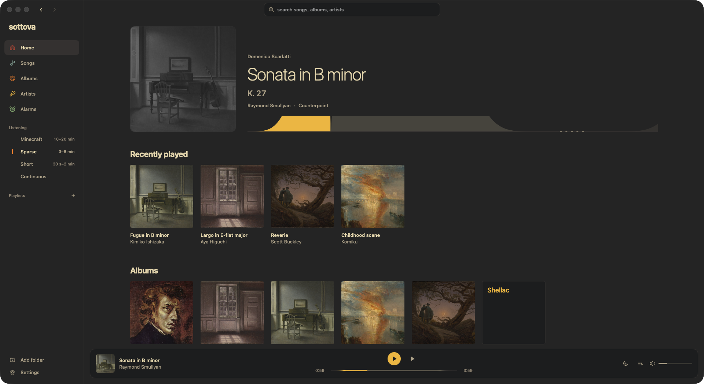

<p align="center">
  
</p>

<h1 align="center">sottova</h1>

<p align="center">a music player for macOS that leaves silence between the songs.</p>

<p align="center">
  <a href="#build-it">build it</a> ·
  <a href="#scripting">scripting</a> ·
  <a href="#what-it-changes-on-your-mac">what it changes on your mac</a> ·
  <a href="LICENSE">GPL-3.0</a>
</p>



sottova plays your own music the way Minecraft plays its soundtrack. each track rises out of silence, falls back into it, and then there's quiet for a while before the next one. you pick how long the quiet lasts.

silence is the point, not a bug. a playlist that never stops turns into wallpaper. a track that shows up after ten minutes of nothing gets heard.

it's a full window for browsing (songs, albums, artists, composers, playlists) and a small panel in the menu bar for when you only want the music.

- **requires** macOS 26 Tahoe or later
- **plays** your own files only. no streaming, no account

## what it does

- plays any folders of local music (mp3, aac, alac, flac, wav, aiff and ogg) and watches them for new files
- fades every track in from silence and back out, then waits a random gap between your shortest and longest
- levels every track to the same loudness (−18 LUFS, peaks under −1 dBTP), measured once per file with [libebur128](https://github.com/jiixyj/libebur128)
- shuffles without repeats: every track plays once before any repeats, and never one of the last 10
- keeps the Mac awake during gaps (the audio engine is off then, so nothing else would), pauses on sleep and resumes after
- shows up in Now Playing, and the media keys and the scrubber work
- gives an album or a playlist its own gaps: Compline plays with ten-minute silences, then hands back to yours
- playlists are `.m3u8` files in `~/Music/Sottova Playlists`, so other players can open them; folders of mixed performers can become playlists in one click
- a queue you can reorder, a sleep timer that eases the music down over its last three minutes, and click-to-seek that fades back in instead of starting loud
- reopens paused where you left off, in the piece or in the silence
- composer pages list each work in catalog order with every recording of it
- covers from a file or from public-domain paintings (the Met, the Art Institute of Chicago, Cleveland), credited inside the jpeg
- alarms: an album or playlist starts itself at a time you set, once or on chosen days, at its own volume
- trim: drag where a track really starts and ends to skip a spoken intro or applause; the file isn't touched
- three palettes: Monochrome, Catppuccin and Gruvbox, in light and dark

## presets

| preset | gap | fade in / out |
| --- | --- | --- |
| Minecraft | 10–20 min | 6 s / 8 s |
| Sparse | 3–8 min | 6 s / 8 s |
| Short | 30 s–2 min | 4 s / 6 s |
| Continuous | none, 4 s equal-power crossfade | 3 s / 3 s |

Minecraft's own delay between overworld tracks is 10 to 20 minutes. change the gaps or fades and the preset becomes Custom; loudness is separate (−14, −18 or −23 LUFS).

## build it

there's no signed release yet, so build it yourself. it needs Xcode 26.

```sh
scripts/run.sh        # debug build, opens from the menu bar
scripts/release.sh    # release zip in .build/release
```

`release.sh` signs with a Developer ID when `SOTTOVA_SIGN_ID` is set and notarizes when `SOTTOVA_NOTARY` names a `notarytool` keychain profile. without them the build only runs on the Mac that built it.

`swift test` runs the engine headless: the state machine, offline renders of the audio graph, and the EBU Tech 3341 loudness signals.

## scripting

links, for hotkey tools and Raycast:

```
sottova://play
sottova://pause
sottova://toggle
sottova://skip
sottova://preset/minecraft
sottova://sleep/45
sottova://sleep/after
sottova://sleep/off
```

every state change rewrites `~/Library/Application Support/Sottova/status.json`:

```json
{"preset":"Short","status":"resting","title":"clip2","nextTrackAt":"2026-10-28T16:42:10Z"}
```

and posts the same thing as the distributed notification `com.alanbagel.sottova.status`. for SketchyBar:

```sh
sketchybar --add event sottova_status com.alanbagel.sottova.status \
           --subscribe sottova sottova_status
```

## files

everything sits in `~/Library/Application Support/Sottova`, as plain files:

- `library.json`: watched folders and the loudness of every file
- `profile.json`: your settings, plus the albums that have their own gaps
- `resume.json`: where playback was when you quit
- `plays.jsonl`: one line per track played, with the gap after it
- `alarms.json`: your alarms
- `trims.json`: where each trimmed track starts and ends
- `status.json`: the current state

nothing leaves your Mac. there's no account and no analytics. the only network access is the painting search, and only while that sheet is open.

## what it changes on your Mac

alarms need the Mac awake, so sottova schedules a system wake two minutes before each one with `pmset`. scheduling a wake needs root. the first time you save an alarm, sottova asks for your password once and adds this rule:

```
/etc/sudoers.d/sottova
<you> ALL=(root) NOPASSWD: /usr/bin/pmset schedule wakeorpoweron *
```

it lets sottova add wakes, and nothing else, without asking again. it's checked with `visudo` before it goes in. wakes are kept two weeks ahead, topped up at launch and whenever the Mac wakes. cancel the password prompt and alarms only play when the Mac is already awake.

to undo it:

```sh
sudo rm /etc/sudoers.d/sottova
pmset -g sched                  # see what's scheduled
sudo pmset schedule cancelall   # removes every scheduled wake, not only sottova's
```

## what it isn't

sottova is a music player. it makes no claims about sleep, focus, stress or health.

## license

copyright (C) 2026 TheSecondComing123. GPL-3.0, see `LICENSE`.

- [libebur128](https://github.com/jiixyj/libebur128) in `Sources/CEbur128`: MIT, see its `LICENSE`
- [Phosphor](https://phosphoricons.com) icons in `Support/Icons`: MIT, see its `LICENSE`
